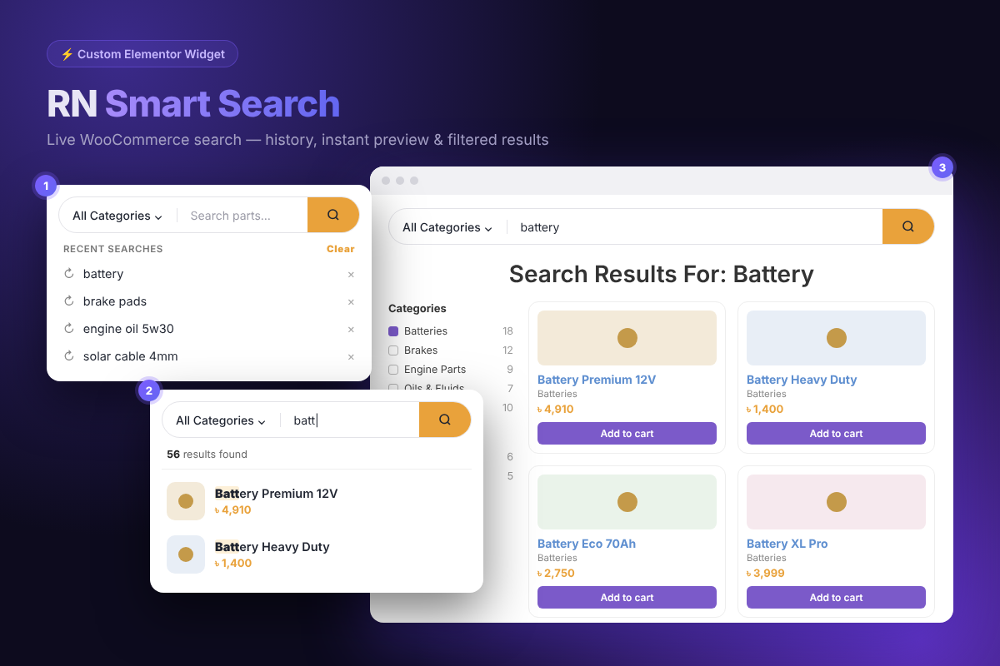
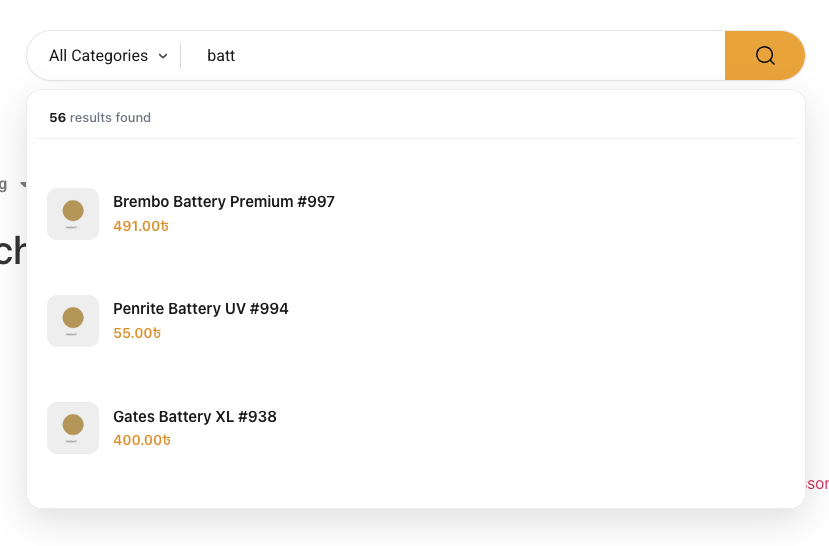

# RN Smart Search

**Live AJAX product search widget for WooCommerce + Elementor** — recent searches, instant product preview, category filter and filtered results pages, built for speed.




---

## ✨ Features

- **Category-aware search bar**: an "All Categories" dropdown limits the search to one product category (with an option to show parent categories only).
- **Live preview panel**: matching products appear as you type, with thumbnail, price, category and a total results count.
- **Recent searches**: each visitor's search history is stored in the browser and shown when they focus the search bar, with remove (×) and **Clear** buttons.
- **Smart navigation**: the search button opens the shop/search results page, and clicking a preview item opens that product.
- **Live filtering on the shop page**: typing can also filter JetEngine Listing Grids / JetSmartFilters product grids on the page, targeted by CSS ID.
- **Fast AJAX mode**: preview requests load only WooCommerce and this plugin, which makes them about **3x faster** under load.
- **Results Count widget**: a second Elementor widget that shows text like *"Showing 1–12 of 56"* for a Listing Grid.
- **Fully styleable**: the search bar, button, dropdown, preview items and history can all be styled from the Elementor panel.
- **Custom result template**: optionally render preview items with your own JetEngine listing template.
- **Flexible "no results" state**: show a custom message, or reveal your own Elementor section by CSS ID.
- **Prices for logged-in users only**: an option for B2B / wholesale stores.



---

## 📋 Requirements

| Requirement | Version |
|---|---|
| WordPress | 6.0+ |
| PHP | 7.4+ |
| WooCommerce | Active |
| Elementor | Active (free version is enough) |
| JetEngine / JetSmartFilters | *Optional*, only needed for live grid filtering and custom listing templates |

---

## 🚀 Installation

> ⚠️ **Important:** the plugin folder **must** be named `rn-smart-search`.
> Fast AJAX mode looks for `rn-smart-search/rn-smart-search.php`. If the folder has any other name (for example `rn-smart-search-main`), the live preview will stop working.

### Option 1: Release ZIP (recommended)

1. Go to **[Releases](../../releases)** and download `rn-smart-search.zip`.
2. In WordPress, go to **Plugins → Add New → Upload Plugin**.
3. Upload the ZIP, then click **Install Now → Activate**.

### Option 2: Git clone

```bash
git clone https://github.com/Reshma62/rn-smart-search.git
cp -R rn-smart-search/rn-smart-search /path/to/wp-content/plugins/
```

Then activate **RN Smart Search** under **Plugins**.

### Option 3: "Download ZIP" button

GitHub's **Code → Download ZIP** gives you `rn-smart-search-main.zip`. Unzip it, then zip **only the inner `rn-smart-search` folder** and upload that ZIP to WordPress.

---

## 🛠 Usage

### 1. Add the search widget

1. Open a page or the header template in **Elementor**.
2. Search the widget panel for **"RN Search"** (it is in the **RN Widgets** category).
3. Drag it onto the page and configure it in the **Content** tab:

| Setting | What it does |
|---|---|
| Placeholder | Text shown inside the empty search box |
| Show category selector | Turns the "All Categories" dropdown on or off |
| Only parent categories | Hides subcategories in the dropdown |
| Show "Uncategorized" | Includes or excludes the Uncategorized category |
| Live preview results | Number of products shown in the preview panel |
| Show live preview panel | Turns live suggestions on or off |
| Show recent searches | Turns search history on or off |
| Show thumbnail / price / category | Chooses what each preview item shows |
| Show price only to logged-in users | Hides prices from guests |
| Show total results | Shows "56 results found" at the top of the preview |
| Custom result template | Renders preview items with a JetEngine listing template |
| No results message | Custom text, or the CSS ID of your own section to show instead |
| Search Button | Icon, button text and icon position |

4. Style everything in the **Style** tab: Search Bar, Button, Dropdown, Preview items.

### 2. Global settings

Go to **WooCommerce → Settings → Products → RN Smart Search**:

| Option | Default | Description |
|---|---|---|
| **Category pages** | ✅ On | Shows only products **directly** in a category and leaves out products that are only in its subcategories. This also applies to the category filter and header search. |
| **Shop grid CSS IDs** | `all-products` | Comma-separated CSS IDs of the product Listing Grids on the shop, category and search pages. The search only affects these grids, so mega menus and other listings are never touched. |
| **Fast search requests** | ✅ On | Loads only WooCommerce + RN Smart Search for preview requests (about 3x faster). Turn this off if another plugin changes product prices or visibility and the preview must respect it. |

### 3. Live filtering of a Listing Grid (optional)

1. Select your JetEngine **Listing Grid** and go to **Advanced → CSS ID**, e.g. `all-products`.
2. Add the same ID under **Shop grid CSS IDs** (global), or in the widget's **Listing grid CSS IDs** field.
3. Turn on **Live filter results on shop** in the widget.

Typing in the search bar now filters that grid directly, and it works together with JetSmartFilters.

### 4. Results Count widget (optional)

1. Drag **"RN Results Count"** next to your product grid.
2. Set **Listing Grid Query ID (CSS ID)** to the grid's CSS ID.
3. Edit the **Template**, e.g. `Showing %start%–%end% of %total%`. Available placeholders: `%start%` `%end%` `%total%` `%page%` `%pages%`.

---

## ⚡ Fast AJAX mode: how it works

When **Fast search requests** is on, the plugin automatically installs a small must-use plugin:

```
wp-content/mu-plugins/rn-search-fast-ajax.php
```

For **live preview requests only** (`action=rn_smart_search`), it skips loading every other plugin (Elementor, JetEngine, etc.) and loads just WooCommerce + RN Smart Search. All other requests are untouched.

- Turning the option off or deactivating the plugin **removes the file automatically**.
- Requests that use a JetEngine listing template always get a full load.
- To force full loading, add this to `wp-config.php`:
  ```php
  define( 'RN_SS_FAST_AJAX_DISABLE', true );
  ```
- To keep an extra plugin loaded during preview requests:
  ```php
  add_filter( 'rn_smart_search_fast_ajax_plugins', function ( $plugins ) {
      $plugins[] = 'my-pricing-plugin/my-pricing-plugin.php';
      return $plugins;
  } );
  ```

---

## 📁 File structure

```
rn-smart-search/
├── rn-smart-search.php              # Main plugin file (bootstrap + Fast AJAX sync)
├── includes/
│   ├── class-rn-search-plugin.php   # Core: assets, widget registration, WC settings, query hooks
│   ├── class-rn-search-ajax.php     # Live preview AJAX endpoint (10-min transient cache)
│   ├── class-rn-grid-search.php     # Listing Grid live search endpoint
│   └── class-rn-debug.php           # Debug helpers
├── widgets/
│   ├── class-rn-search-widget.php         # "RN Search" Elementor widget
│   └── class-rn-results-count-widget.php  # "RN Results Count" Elementor widget
├── assets/
│   ├── css/rn-search(.min).css
│   └── js/rn-search(.min).js, rn-results-count(.min).js
└── mu-plugin/
    └── rn-search-fast-ajax.php      # Bundled copy, installed into mu-plugins
```

---

## ❓ Troubleshooting

| Problem | Fix |
|---|---|
| Live preview shows nothing | Check that the plugin folder is named exactly `rn-smart-search`, then deactivate and reactivate the plugin. |
| Preview prices differ from the shop | Turn **Fast search requests** off, or add your pricing plugin with the `rn_smart_search_fast_ajax_plugins` filter. |
| Search changes the wrong grid | Check **Shop grid CSS IDs**. Only the grids listed there are affected. |
| Widget doesn't appear in Elementor | Make sure WooCommerce **and** Elementor are both active (an admin notice tells you which one is missing). |
| `mu-plugins` file not created | `wp-content/mu-plugins` must be writable. The plugin still works, just without the speed boost. |

---

## 📝 Changelog

**1.26.1**
- Renamed from MP Smart Search to **RN Smart Search** (new prefixes, text domain and option names).

---

## 👩‍💻 Author

**Reshma Khanam**, WordPress & Full-Stack Developer
🌐 [devreshmakhanam.com](https://devreshmakhanam.com) · 💼 [LinkedIn](https://www.linkedin.com/in/reshma-khanam62/) · 🐙 [GitHub](https://github.com/Reshma62)

Need a custom WordPress plugin, Elementor widget or JetEngine solution? [Get in touch](https://devreshmakhanam.com/#contact).

## 📄 License

GPL-2.0-or-later. See [LICENSE](rn-smart-search/LICENSE).
